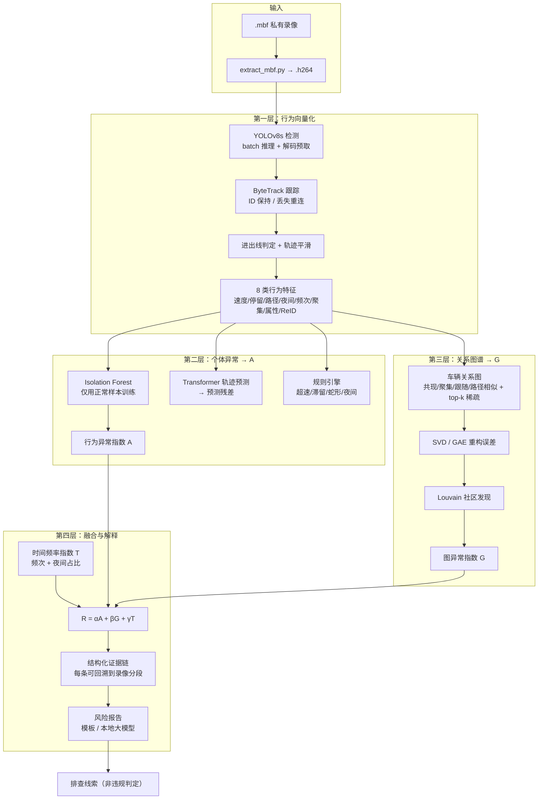

# 综保区车辆行为向量化与异常排查系统

本项目面向综合保税区监管场景，目标是把监控视频中的车辆通行过程转化为结构化行为数据，并为后续异常检测、空间语义拓扑分析、企业/车辆/司机关系风险研判提供数据基础。

当前系统已贯通**四层链路**：视频行为向量化 → 无监督异常检测 → 车辆关系图谱 → 多维风险融合与大模型报告，并具备跨摄像头同车关联、模型增量更新、容器化部署与端到端冒烟测试。

需要明确的是：系统输出的是**排查线索**，不是违规判定；召回率、精确率等指标依赖现场标注数据，当前状态见 [`ACCEPTANCE_REPORT.md`](ACCEPTANCE_REPORT.md)。

- **一页纸交付说明**：[`START_HERE.md`](START_HERE.md)（先看这个）
- **目标完成情况**：[`GOAL_STATUS.md`](GOAL_STATUS.md)（哪些达标、为什么没达标、需要你做什么）
- **代码审查整改报告**：[`AUDIT_REPORT.md`](AUDIT_REPORT.md)（8 条缺陷的整改与回归测试）
- 交付总览：[`DELIVERY.md`](DELIVERY.md)
- 技术指标自评：[`ACCEPTANCE_REPORT.md`](ACCEPTANCE_REPORT.md)
- 指标验证路径对照：[`METRICS_TRACEABILITY.md`](METRICS_TRACEABILITY.md)
- 技术文献参考：[`REFERENCES.md`](REFERENCES.md)（国内外文献、与指标/模块的对应关系）
- 车牌昼夜评测：[`PLATE_OCR_EVAL.md`](PLATE_OCR_EVAL.md)（白天/夜晚识别率对照与机理）
- 性能剖析与优化路线：[`PERFORMANCE.md`](PERFORMANCE.md)
- 经济效益与社会效益测算：[`BENEFITS.md`](BENEFITS.md)
- 运行维护手册：[`OPERATIONS.md`](OPERATIONS.md)
- 现场数据采集需求：[`DATA_REQUIREMENTS.md`](DATA_REQUIREMENTS.md)
- 端到端演示：[`demo/README.md`](demo/README.md)

## 核心思路

项目要回答的不是"有没有车"，而是：

```text
哪些车辆或司机需要重点关注？
为什么需要关注？
证据是什么？
应该如何排查？
```

系统分为四层，每层产出一个可解释的中间量：



四层均已实现。指标口径见 [`ACCEPTANCE_REPORT.md`](ACCEPTANCE_REPORT.md)，
逐项验证路径见 [`METRICS_TRACEABILITY.md`](METRICS_TRACEABILITY.md)，
性能瓶颈与优化路线见 [`PERFORMANCE.md`](PERFORMANCE.md)。

## 当前能力

- YOLOv8 车辆检测。
- ROI 过滤。
- 简化 ByteTrack 跟踪。
- 短暂丢失轨迹恢复。
- 轨迹提取和平滑。
- 行为向量计算：
  - 平均速度
- 速度变异系数
  - 最大速度
  - 停留时长
  - 停留次数
  - 路径平滑度
  - 夜间通行
  - 高频通行指数
  - 聚集行为指数
- 车辆属性提取：
  - 车型粗分类，区分普通车辆和货车
  - 颜色识别
  - 车牌区域检测
  - OCR 接口
  - ReID 接口
- 每段视频独立处理，避免跨视频状态污染。
- 支持从监控下载文件名解析录像时间。
- 支持几何配置等级和可靠性字段。
- 支持日聚合骨架。
- 支持中文变更日志。

## 当前限制

> 全部为**实测或已知**的限制，对应的指标状态见 [`ACCEPTANCE_REPORT.md`](ACCEPTANCE_REPORT.md)。

**几何与成像**

- 未配置 ROI 的摄像头会使用全画面，可能混入路边停车或无关道路车辆；
- 未透视标定的摄像头，速度、路径偏离、车辆间距**不作正式风险依据**
  （字段 `speed_reliable=0` / `path_reliable=0`，相关规则自动跳过——这是设计行为，不是故障）；
- 远景车牌像素不足：实测 1080p 下车牌高约 60px，easyocr 会把 `87316` 读成 `873061`，
  省份汉字读不出 → **车牌不作身份依据**（宁可不出，也不输出错误车牌）。

**识别能力**

- 跨机位 Re-ID：自动构造的同车/异车评估显示 **AUC 0.794、EER 28%**（加属性先验 0.827），
  远未达到 90% 目标；HSV / ImageNet-ResNet50 / OSNet(行人模型) 三种替代方案更差；
- 序列号/团伙/边准确率等指标缺真实标注，无法计算 AUC。

**时间与场景**

- 该行政车道**夜间基本无车**（00:00 与 20:57 两段 ROI 内检出均为 0），
  所以"夜间规则"很少在真实数据中触发；反过来，夜间一旦出现车辆就是强信号；
- 未接入企业、司机、仓库、申报单、车辆授权关系（系统设计上**只依赖视频**）；
- 园区空间语义地图和摄像头拓扑已有配置骨架，仍需填入真实道路、摄像头与业务路线。

**性能与规模**

- 20 路 1080P 未达标：端到端 **8.4 路**、`frame_skip=2` 时 **12.7 路**；
  GPU ReID / TensorRT 在本机（CUDA 11.8）不可用，见 [`PERFORMANCE.md`](PERFORMANCE.md)；
- 7×24 稳定性只做了 300 轮浸泡（25 分钟），未做完整 72 小时。

> 已集成说明：`anomaly_score` / `is_anomaly` / `alert_reason` 与图谱、风险融合、报告
> **已由 `run_full_pipeline.py` 串成一次运行**，不再需要分步执行（分步脚本仍保留，便于单独调试）。

## 项目结构

```text
vehicle_tracking_system/
├── README.md / CHANGELOG.md / CODE_STRUCTURE.md    # 使用说明、变更日志、按目录的代码结构
├── ACCEPTANCE_REPORT.md / METRICS_TRACEABILITY.md  # 指标验收结论、逐项复现路径
├── AUDIT_REPORT.md / GOAL_STATUS.md                # 代码审查整改、目标达成状态
├── DELIVERY.md / OPERATIONS.md / PERFORMANCE.md    # 交付清单、运维、性能基准
├── FEASIBILITY_REPORT.md / DATA_REQUIREMENTS.md    # 可行性、数据需求
├── BENEFITS.md / ANOMALY_SIGNATURES.md / START_HERE.md
├── Dockerfile / docker-compose.yml                 # 容器化部署
├── requirements.txt                                # Python 依赖
├── config.yaml                                     # 根级运行配置
├── config/
│   ├── default.yaml / model_config.yaml            # 全局默认配置、车辆属性模型配置
│   ├── behavior_config.yaml / anomaly_config.yaml  # 行为特征配置、异常检测与规则阈值
│   ├── camera/                                     # 单摄像头 ROI、进出线、标定配置
│   ├── site/                                       # 区域拓扑与机位关系
│   ├── calibration_measurements.csv                # 现场实测标定记录
│   └── label_template.csv                          # 人工标注模板
├── scripts/                                        # 命令行入口与工具脚本，按用途分组：
│   ├── 流水线      run_pipeline / run_batch / run_batch_day / run_full_pipeline
│   │               run_windowed / run_multi_camera / run_anomaly_detection
│   ├── 训练与标定  train_iforest / train_transformer / build_baseline
│   │               calibrate_camera / calibrate_homography / calibrate_alert_rate
│   ├── 图谱与风险  build_graph / build_risk_report / export_gang_case
│   ├── 评测与验证  eval_system / eval_with_labels / eval_temporal_holdout
│   │               eval_reid_pairs / eval_gae_transfer / synthetic_anomaly_eval
│   │               smoke_test / soak_test / delivery_check / report_metrics
│   ├── 性能基准    benchmark_throughput / benchmark_batch / benchmark_multiprocess
│   ├── 数据与工具  extract_mbf / stitch_cameras / audit_vector_columns / audit_rules
│   │               render_camera_config / make_calibration_figure / build_demo_pack
│   └── 文档与演示  build_agent_experience_doc / merge_docx / insert_docx_paras
│                   replace_docx_paras / check_docx / demo_alert_budget_bug
├── src/
│   ├── detection/           # YOLO 检测与 ROI 过滤
│   ├── tracking/            # ByteTrack 跟踪、tracklet 管理
│   ├── trajectory/          # 场景几何、单应矩阵、轨迹提取/平滑/拼接
│   ├── behavior/            # 8 维行为特征与行为向量化
│   ├── feature_extraction/  # 颜色、车型、车牌、OCR、ReID
│   ├── anomaly/             # Isolation Forest、Transformer 残差、规则引擎、告警预算
│   ├── graph/               # 车辆关系图谱、社区发现、GAE 图异常指数
│   ├── risk/                # 风险融合、证据链、报告生成
│   ├── report/              # 指标汇总
│   ├── site/                # 区域拓扑、机位关系与场景语义
│   ├── pipeline/            # 视频处理、批处理、日聚合
│   ├── output/              # 向量、事件、告警 CSV/JSON 输出
│   ├── visualization/       # 可视化绘制与标注视频
│   └── utils/               # 线程预取读帧、MBF 抽取、日志等
├── tests/                   # 回归测试：51 个文件、409 条用例
├── web/
│   └── map_editor/          # 园区地图编辑器（纯前端，直接打开 index.html）
├── docs/                    # 标定指南与配图
├── demo/                    # 演示样例（团伙案例、风险报告）
├── deploy/                  # 部署说明
├── models/                  # YOLO 权重与训练产物
├── data/
│   ├── videos/              # 现场 MBF 录像
│   ├── test_videos/         # 测试片段
│   ├── outputs/             # 各阶段产物（向量、事件、告警、评测结果）
│   ├── references/          # 基线与模型 JSON
│   └── validation/          # 人工标注与校验结果
└── tmp/                     # 临时产物，不提交
```

运行产物（`data/outputs/`、`data/references/`、`data/validation/`）不进版本库，
复现需要先跑对应阶段的脚本。

## 环境准备

```bash
pip install -r requirements.txt
```

模型权重放在：

```text
models/yolov8s.pt
```

当前仓库中已有 YOLO 权重文件。后续如果迁移仓库，建议改为外部下载或 Git LFS 管理。

## 园区地图编辑器

直接打开 `web/map_editor/index.html`，无需安装前端依赖。编辑器以综保区 A 区围网图为底图，支持添加和维护企业区域、道路、摄像头及其属性，并支持本地自动保存、撤销重做、JSON 导入导出和 PNG 导出。

地图坐标采用底图像素坐标，不是经纬度。获得 CAD 或现场测量坐标后，可再转换到 `config/site/` 的园区拓扑配置。

## 现场 MBF 录像转换

现场导出的 `.mbf` 录像内部是标准 H.264 Annex B 裸流，但 OpenCV 不能直接读取。先转换为 `.h264`：

```bash
python scripts/extract_mbf.py \
  --input "F:/A区录像 新/行政车道进" \
  --output data/outputs/h264/admin_in
```

转换后即可用 `run_pipeline.py` 直接处理：

```bash
python scripts/run_pipeline.py \
  --video data/outputs/h264/admin_in/<录像文件名>.h264 \
  --camera admin_in \
  --output data/outputs
```

## 一键端到端原型

从一段视频直接产出行为向量、告警、关系图谱和风险报告：

```bash
python scripts/run_full_pipeline.py \
  --input data/outputs/h264/admin_in/<录像文件名>.h264 \
  --camera admin_in \
  --output data/outputs/proto \
  --max-frames 3000
```

支持 `.mp4` / `.h264` / `.mbf`；模型缺失时会自动训练。输出：

- `alerts/alerts_<camera>.csv`：告警；
- `graphs/graph_<camera>.json`：关系图谱与图异常指数 G；
- `risk/risk_<camera>.json|md`：风险融合与排查报告。

## 全天批量处理

处理一整天所有录像（自动转 h264、断点续跑）：

```bash
python scripts/run_batch_day.py \
  --mbf-dir "F:/A区录像 新/行政车道进" \
  --camera admin_in \
  --output data/outputs/day_20260901 \
  --max-frames 600
```

- 默认跳过已处理的分段（`--force` 强制重跑）；
- `--only 8,10,12` 只处理指定分段（按文件名时间顺序的 1-based 序号）；
- 同一小时内的多个分段会带开始时间后缀，避免互相覆盖；
- 进度与结果写入 `batch_day_summary.json`。

## 多机位与全局身份回灌

先对每个机位分别产出向量，再把相邻机位拼接成全局车辆身份：

```bash
python scripts/run_multi_camera.py \
  --cameras "admin_in=data/outputs/e2e/vectors/admin_in,admin_out=data/outputs/day_20260901/vectors/admin_out" \
  --pairs "admin_in:admin_out" \
  --output data/outputs/multi_camera.json \
  --write-back data/outputs/multi_camera_wb
```

`--write-back` 会额外产出四类文件：

- `vectors/<camera>.csv`：回填了 `global_vehicle_id` 与 `cross_camera_partners` 的向量；
- `graph_global.json`：**按全局身份建图**，同一辆车跨机位只算一个节点；
- `risk_global.json`：按身份合并的风险记录（证据去重、伙伴取并集、带 `passage_count`）；
- `summary.json`：身份覆盖率、合并后车辆数、多机位车辆数。

约定：**一个全局身份 = 一个图节点 = 一条风险记录**；没拼接上的通行保持独立，
不会被强行并成一辆车。

> 当前仓库没有时间同步的双机位录像，拼接匹配数为 0 属于**数据缺口**而不是代码问题；
> 回灌链路的正确性由 `tests/test_global_identity.py` 的 8 个用例覆盖。

## 性能基准

```bash
python scripts/benchmark_throughput.py \
  --video data/outputs/h264/admin_in/<录像>.h264 \
  --camera admin_in \
  --frames 200
```

实测（RTX 3060 Laptop 6GB，1080p，不跳帧）：

| 配置 | 端到端 FPS | 按 15 FPS/路折算 |
|---|---|---|
| 无解码预取（batch=16） | 98.0 | 约 6.5 路 |
| **解码预取 + batch=16（默认）** | **124.5** | **约 8.3 路** |
| 解码预取 + batch=32 | 125.6 | 约 8.4 路 |
| 解码预取 + batch=32 + `frame_skip=2` | **190.6** | **约 12.7 路** |

批处理推理（`pipeline.batch_size`）把多帧合并成一次 YOLO 前向；解码预取（`pipeline.prefetch_frames`）
用独立线程解码，与推理重叠。两者叠加比逐帧提升约 2.3 倍。

进一步分析（`cProfile` 实测，详见 [`PERFORMANCE.md`](PERFORMANCE.md)）：

- **解码占单帧时间 25.6%**，是最大单项——"解码不是瓶颈"的旧结论不成立
  （那时测的是"纯解码循环"的 337 FPS，与流水线中的并发场景不同）；
- ReID 每辆约 111ms、跑在 CPU，占 9.6%；
- **跟踪/特征提取等 Python 逻辑没有进入热点前 8**，"瓶颈在逐帧 Python"的旧判断不成立；
- 当前真正的瓶颈：解码（已用独立线程重叠）+ 检测推理（需 TensorRT 才能再上一档）。

距离“单卡 20 路 1080P”仍差约 2.6 倍，继续提升需要 C++/TensorRT 推理管线，或把跟踪/裁剪也移到 GPU。

### 端到端延迟

`run_full_pipeline.py` 处理 1 分钟视频（1500 帧）到输出风险报告：

| 场景 | 耗时 |
|---|---|
| 冷启动（含模型训练） | 24.9s |
| 热运行 | 23.1s |

产出 15 辆车、2 条中风险，折合单车摊销约 1.5s，满足“≤2 分钟”指标。延迟随片段长度线性增长，长视频建议按短窗口流式处理。

## 端到端演示

`demo/` 目录记录了从现场 `.mbf` 到风险报告的完整运行结果：

```text
现场 .mbf (236 MB) → .h264 (234 MB) → 3000 帧全链路 → 7 辆车 / 1 条中风险
```

- 步骤与命令：[demo/README.md](demo/README.md)
- 实际报告样例：[demo/risk_sample.md](demo/risk_sample.md)

## 单视频运行

基本命令：

```bash
python scripts/run_pipeline.py \
  --video data/test_videos/test_cam01_5min.mp4 \
  --camera cam01 \
  --output data/outputs
```

处理外部视频示例：

```bash
python scripts/run_pipeline.py \
  --video "F:\test_videos\centerlode_north\Download_CH05综保区A区中央路北_20260422080046_20260422093204_202606010928376.mp4" \
  --camera centerlode_north \
  --output data/outputs \
  --max-frames 1500
```

参数说明：

| 参数 | 说明 |
|---|---|
| `--video` | 输入视频路径 |
| `--camera` | 摄像头 ID，对应 `config/camera/<camera_id>.yaml` |
| `--config` | 全局配置文件，默认 `config/default.yaml` |
| `--output` | 输出根目录 |
| `--output-video` | 可选，输出标注后视频 |
| `--max-frames` | 最大处理帧数，调试时使用，`0` 表示不限制 |
| `--device` | GPU 编号，`-1` 表示 CPU |

## 批量运行

```bash
python scripts/run_batch.py \
  --camera cam01 \
  --date 20260422 \
  --video-dir data/videos/camera_01 \
  --output data/outputs
```

批量处理会逐段视频运行。当前处理器会在每段视频开始前清空轨迹状态，避免上一段视频的 `track_id`、频次统计和已完成向量污染下一段。

## 输出结果

行为向量 CSV 输出位置：

```text
data/outputs/vectors/<camera_id>/<date>/vec_<camera_id>_<date>_<hour>.csv
```

示例：

```text
data/outputs/vectors/cam01/20260422/vec_cam01_20260422_08.csv
```

主要字段：

| 字段 | 说明 |
|---|---|
| `track_id` | 当前视频段内轨迹 ID |
| `passage_id` | 全局唯一通行 ID：摄像头_录像段起始时间_track_id |
| `global_vehicle_id` | 日聚合后的全局车辆 ID |
| `segment_count` | 日聚合合并的视频段数 |
| `camera_id` | 摄像头 ID |
| `vehicle_type` | 车辆类型，如 sedan/suv/mpv/truck/bus |`r`n| `vehicle_group` | 车辆研判分组，如 ordinary/freight/large_passenger |`r`n| `analysis_target` | 是否纳入行政通道异常分析 |
| `vehicle_color` | 车辆颜色 |
| `plate_number` | OCR 识别车牌号，可能为空 |
| `plate_hash` | 车牌哈希 |
| `plate_confidence` | OCR 车牌识别置信度，低置信时 `plate_number` 为空 |
| `geometry_level` | 摄像头几何配置等级 |
| `speed_reliable` | 速度字段是否可靠 |
| `path_reliable` | 路径偏离字段是否可靠 |
| `aggregation_reliable` | 空间聚集字段是否可靠 |
| `passage_reliable` | 进出通行判断是否可靠 |
| `enter_time` | 车辆首次进入/出现时间 |
| `exit_time` | 车辆离开/最后出现时间 |
| `duration_sec` | 持续时间，秒 |
| `trajectory_length_m` | 轨迹长度，米，未标定时仅为估算 |
| `avg_speed_ms` | 平均速度，m/s，未标定时不建议用于告警 |
| `max_speed_ms` | 最大速度，m/s，未标定时不建议用于告警 |
| `speed_variance` | 速度方差 |
| `speed_cv` | 速度变异系数（标准差/均值），衡量车速稳定性；研究要点一要求的特征 |
| `max_dwell_sec` | 最大停留时间 |
| `stop_count` | 停留次数 |
| `dwell_ratio` | 停留占比 |
| `path_deviation` | 路径偏离度 |
| `path_smoothness` | 路径平滑度 |
| `is_night` | 是否夜间 |
| `night_ratio` | 夜间占比 |
| `freq_index` | 高频通行指数 |
| `freq_count_24h` | 24 小时频次计数 |
| `aggregation_index` | 聚集行为指数 |
| `nearest_vehicle_m` | 最近车辆距离，米 |
| `max_concurrent_vehicles` | 该车通行期间画面内同时出现的最大车辆数 |
| `trajectory_points` | 轨迹点序列 |
| `reid_embedding` | ReID 特征向量 |
| `anomaly_score` | 统计基线 Z-score 异常分数 |
| `is_anomaly` | 是否异常（规则/基线/Isolation Forest 任一命中） |
| `alert_reason` | 告警原因 |
| `iforest_score` | 无监督异常指数 A（0~1，越大越异常） |
| `iforest_anomaly` | Isolation Forest 是否判为异常 |

## 行政通道分析范围

本项目当前判断对象限定为行政通道普通车辆，货运通道车辆不纳入异常判断。检测阶段仍保留 `truck`、`bus`、`motorcycle` 等类别，用于识别和排除不属于行政通道研判范围的车辆。

车辆类型字段分两层：

| 字段 | 说明 |
|---|---|
| `vehicle_type` | 模型或启发式分类结果，如 `sedan`、`suv`、`mpv`、`truck`、`bus` |
| `vehicle_group` | 研判分组，如 `ordinary`、`freight`、`large_passenger`、`two_wheeler` |
| `analysis_target` | 是否纳入行政通道异常分析，普通车为 `1`，货车等默认 `0` |

Phase 3 默认只对 `vehicle_group = ordinary` 的车辆训练基线和生成告警。货车记录会保留在向量和事件 CSV 中，便于复核模型是否正确区分，但不会参与行政通道风险判断。

**实测校验（66 分钟、444 次通行）**：

| vehicle_group / vehicle_type | 数量 | analysis_target |
|---|---|---|
| ordinary / sedan | 418 | 1 |
| ordinary / suv | 14 | 1 |
| **freight / truck** | **8** | 0 |
| **two_wheeler / motorcycle** | **4** | 0 |

`ordinary` 合计 **432**，与参与分析的车辆数完全一致；被排除的 **12 辆正是 8 辆卡车 + 4 辆摩托车**——
说明类型判定与排除逻辑工作正常，不是误杀。

> 注意：这条行政车道**并非只有轿车**——66 分钟里有 12 次货运/两轮车通行（占 2.7%），
> 只是它们不进入行政通道的异常研判。
## Phase 3 基线和告警

Phase 3 不直接重跑视频检测，而是读取 Phase 1/2 已生成的行为向量 CSV，建立正常行为基线并输出告警 CSV。

构建单摄像头正常行为基线：

```bash
python scripts/build_baseline.py \
  --vector-dir data/outputs/vectors/cam01 \
  --camera cam01 \
  --output data/references/baseline_cam01.json
```

运行异常检测：

```bash
python scripts/run_anomaly_detection.py \
  --input data/outputs/vectors/cam01 \
  --baseline data/references/baseline_cam01.json \
  --output data/outputs/alerts/alerts_cam01.csv
```

告警 CSV 输出位置建议为：

```text
data/outputs/alerts/alerts_<camera_id>.csv
```

当前 Phase 3 基础框架包含两类判断：

| 类型 | 说明 |
|---|---|
| 规则告警 | 超速、长时间滞留、路径偏离、夜间频繁停留 |
| 统计基线 | 使用历史正常行为的均值和标准差计算各字段 Z-score |

Phase 3 默认只分析 `ordinary` 普通车辆；货车等非行政通道研判对象会保留记录但不参与告警。规则和统计基线都会尊重可靠性字段。比如 `speed_reliable = 0` 时，不使用速度触发超速告警；`path_reliable = 0` 时，不使用路径偏离触发告警。

### 无监督增强（研究要点二）

除了规则和 Z-score 统计基线，Phase 3 还支持两条无监督路径：

```bash
# 路径二：Isolation Forest，输出行为异常指数 A（iforest_score）
python scripts/train_iforest.py \
  --input data/outputs/vectors/cam01 \
  --output data/references/iforest_cam01.json

# 路径一：Transformer 轨迹预测，用预测残差判异（traj_residual）
python scripts/train_transformer.py \
  --input data/outputs/vectors/cam01 \
  --output data/references/traj_cam01 \
  --past-len 5 --future-len 5 --epochs 20

# 检测时同时加载两个模型
python scripts/run_anomaly_detection.py \
  --input data/outputs/vectors/cam01 \
  --iforest data/references/iforest_cam01.json \
  --trajectory-model data/references/traj_cam01 \
  --output data/outputs/alerts/alerts_cam01.csv
```

说明：

- `iforest_score` 即“行为异常指数 A”，范围 0~1，越大越异常；
- `traj_residual` 是 Transformer 对未来轨迹的预测位移残差（像素），越大越异常；
- 两者都只对 `ordinary` 普通车辆生效，并尊重可靠性字段。

## 车辆关系图谱与社区发现

研究要点三：从行为向量中自动抽取车辆间的共现、跟随、路径相似关系，构建“车辆—车辆”图谱，识别异常团伙。

```bash
python scripts/build_graph.py \
  --input data/outputs/vectors/cam01 \
  --output data/outputs/graphs/graph_cam01.json \
  --top-k 3
```

`--top-k` 表示每个节点只保留最相似的 k 个邻居（默认 3）。单车道场景下轨迹普遍相似，不加限制会退化成完全图；top-k 稀疏化后模块度通常能从 0.05 提升到 0.5 以上。

**`top_k` 的实测敏感性**（444 辆车）：

| top_k | 边数 | 社区数 | 模块度 Q | G 中位数 | G p90 | 最大社区 |
|---|---|---|---|---|---|---|
| 1 | 625 | 145 | **0.8757** | 0.334 | 0.625 | 6 |
| 2 | 1070 | 127 | 0.7462 | 0.410 | 0.637 | 8 |
| **3（默认）** | **1427** | **105** | **0.7348** | **0.511** | **0.712** | **10** |
| 5 | 2060 | 96 | 0.5875 | 0.527 | 0.770 | 13 |
| 8 | 2897 | 78 | 0.4468 | 0.515 | 0.777 | **35** |

- `top_k=1` 模块度最高但图过稀（625 条边），G 中位数偏低；
- `top_k=8` 时模块度掉到 0.447，并出现**35 辆车的巨型社区**（过度合并）；
- **默认 3 是中间档**：Q=0.735、最大社区 10 辆，结构清晰且不吞并。

**社区规模分布**（105 个社区 / 432 个节点）：

| 规模 | 2 | 3 | 4 | 5 | 6 | 7 | 8 | 9 | 10 |
|---|---|---|---|---|---|---|---|---|---|
| 社区数 | 23 | 26 | 18 | 17 | 7 | 6 | 6 | 1 | 1 |

- **没有孤立节点**（`top_k=3` 保证每个节点都有邻居），最小社区 2 辆；
- 中位规模 4 辆，最大 10 辆；
- **≥3 节点的社区 82 个**（78%）——这是"团伙候选"的可用集合；
- 没有出现"一个社区吞掉半张图"的退化情况。

> ⚠️ **G 是"本次运行内的相对值"**：`graph_anomaly_index` 经过 min-max 归一化，
> 所以每次运行的 G 最大值恒为 1.0。**不同 top_k、不同数据集的 G 不能直接比较**，
> 只能在同一张图内比较谁更异常。判断绝对异常程度请看 `reconstruction_error` 原始值。


图异常指数 G 默认用低秩 SVD 重构（`--method svd`）。也可切换为图自编码器：

```bash
python scripts/build_graph.py --input ... --output ... --method gae --gae-epochs 200
```

注意：单张图上“训练图=评分图”的 GAE 自监督不够稳定，建议后续用“正常基线图训练 + 目标图评分”。

输出 JSON 包含：

- `nodes`：车辆节点、所属社区、图异常指数 G（0~1）、重构残差、度、聚类系数；
- `communities`：社区规模、内部权重、密度，供人工复核团伙；
- `edges`：`co_occurrence`（共现）、`following`（跟随）、`path_similarity`（路径相似）三类关系。

当前图异常指数 G 采用邻接矩阵低秩 SVD 重构残差（线性图自编码器基线）；神经图自编码器（GAE/VGAE）属于后续工作。

## 跨摄像头同车关联

```bash
python scripts/stitch_cameras.py \
  --from-vectors data/outputs/vectors/cam_up \
  --to-vectors data/outputs/vectors/cam_down \
  --from-camera cam_up \
  --to-camera cam_down \
  --output data/outputs/stitch/cam_up_to_down.json
```

匹配逻辑：

1. 用 `config/site/topology.yaml` 的通行时间窗口筛选候选；
2. 用 ReID 余弦相似度做一对一贪心匹配；
3. 用并查集合并为 `global_vehicle_id`。

当前 ReID 为 HSV 直方图 fallback，接入正式 ReID 模型后可直接复用。

## 多维度风险融合与排查报告

研究要点四：融合行为异常指数 A、图异常指数 G、时间频率异常指数 T，得到综合风险 R，并生成结构化证据链和排查报告。

```bash
python scripts/build_risk_report.py \
  --input data/outputs/alerts/vectors_cam01.csv \
  --graph data/outputs/graphs/graph_cam01.json \
  --output data/outputs/risk/risk_cam01.json \
  --markdown data/outputs/risk/risk_cam01.md
```

融合公式：

```text
R = αA + βG + γT        （默认 α=0.4、β=0.35、γ=0.25，自动归一化）
```

- `A`：`iforest_score`（Isolation Forest 行为异常指数）；
- `G`：`graph_anomaly_index`（图异常指数）；
- `T`：`time_freq_index`（时间频率异常指数：24h 频次、夜间占比、夜间标记）。

**权重敏感性**（444 辆车，改权重后重算 R）：

| 权重 | 高风险 | 中风险 | R 最高 | R 中位数 | 与默认 Top10 重合 |
|---|---|---|---|---|---|
| **0.40 / 0.35 / 0.25（默认）** | **0** | **8** | **59.0** | 35.5 | 10/10 |
| 1/3 / 1/3 / 1/3 | 0 | 1 | 53.3 | 31.8 | 8/10 |
| 0.60 / 0.20 / 0.20（A 为主） | 0 | 14 | 57.0 | 36.8 | 4/10 |
| 0.20 / 0.60 / 0.20（G 为主） | 0 | **67** | 70.9 | 39.5 | 7/10 |
| 0.20 / 0.20 / 0.60（T 为主） | 0 | 0 | 32.0 | 19.1 | 8/10 |
| 只用 A | 3 | 73 | 82.2 | 43.0 | **1/10** |
| 只用 G | **26** | 210 | 100.0 | 50.9 | 7/10 |

要点：

- **"8 辆中风险"是默认权重的直接结果**——换成等权重只剩 1 辆，G 为主则涨到 67 辆；
- **"0 辆高风险"不是"没有高危车"，而是当前权重下 R 最高只有 59 分，80 分档够不到**。
  要把 80 档激活，得提高 β（G 是 min-max 归一化的，最大值恒为 1.0，能把 R 顶到 100）
  或下调 80 分阈值；
- 只用 G 会产生 26 辆高风险——显然过拟合到图结构，**不建议**。

**有效权重 ≠ 标称权重**（同样 444 辆实测）：

| 维度 | 实测范围 | 标称权重 | **最大贡献** |
|---|---|---|---|
| A（`iforest_score`） | 0.000 – **0.822** | 0.40 | **0.329** |
| G（`graph_anomaly_index`） | 0.000 – **1.000** | 0.35 | **0.350** |
| T | 全 0（本段无夜间/高频） | 0.25 | 0.000 |

`A` 的上界是 IF 分数公式决定的 0.822（不是 min-max），`G` 恒能到 1.0，
因此**标称 α>β，实际最大贡献反而是 G 更大**（0.350 vs 0.329）。差 6%，不算错误，
但说明调权重时不能只看标称数字。

> **T 在本数据上恒为 0**：`time_freq_index` 依赖 `freq_count_24h`，后者依赖 `plate_hash`
> （车牌识别）。实测 444 辆里只有 **2 辆**有车牌哈希，通行次数恒为 1 → T 恒为 0。
> 所以 `R = 0.4A + 0.35G + 0.25×0` 在当前数据上**实际只有两项**。
> 要激活 T 需要**两个**条件：① 可用的车牌识别或跨天 Re-ID（识别同一辆车）；
> ② 足够长的时间窗（当前只有 66 分钟，444 辆车 444 次通行，每车只出现一次，
> 日内高频无从观察）。详见 `ACCEPTANCE_REPORT.md` 第 3.2 节。

**多信号印证不提升风险**（实测）：5 辆被 ≥2 个独立信号命中的车**全部是低风险**：

```text
89   IF+TF+规则  R=39.7  A=0.82 G=0.19
231  IF+TF+规则  R=39.7  A=0.74 G=0.29
171  IF+TF       R=43.5  A=0.64 G=0.51
273  IF+规则      R=32.8  A=0.69 G=0.15
935  IF+TF       R=26.8  A=0.66 G=0.01
```

原因是它们属于"个体异常"而非"群体成员"，G 很低；而 8 辆中风险里有 5 辆 G≥0.91。

> 当前融合是**"图优先"**的：进入中风险主要靠 G，个体异常哪怕三信号同时命中也不足以抬高 R。
> 若业务上希望"多信号印证 = 高优先级"，应在融合层加**印证规则**
> （如 ≥2 个独立信号时至少给 medium），而不是继续调 α/β/γ。当前实现没有这条规则，属有意简化。

**可选：开启印证规则**（默认关闭）

```bash
python scripts/build_risk_report.py ... --corroboration
```

开启后：同一辆车被 **≥2 个独立信号**（Isolation Forest / Transformer 残差 / 预设规则）
命中时，即使加权分不足也提升到 medium。实测同输入下：

| 模式 | 高风险 | 中风险 | R 最高 |
|---|---|---|---|
| 默认 | 0 | **8** | 59.0 |
| `--corroboration` | 0 | **13**（+5） | 59.0 |

新增的 5 辆正是"多信号但图异常低"的个体异常车（89、231、171、273、935）。

## 极少样本场景：待核查清单、抗规避与盲评

违规夹带这类目标一年只有个位数样本、且没有查验台账，因此**不能用"告警率/准确率"来衡量**。
按下面三个工具使用：

### 1. 待核查清单（排名制，不设异常阈值）

```bash
python scripts/build_review_list.py \
  --risk data/outputs/e2e/risk/risk_admin_in.json \
  --budget 20 \
  --output data/outputs/review/review_list.csv
```

输出按可疑度排序的前 N 辆，带证据摘要，**不产生 `is_anomaly` 判定**。
"每周推荐 20 辆"是预算，不是告警率。

### 2. 抗规避测试（会不会被摸规律绕过）

```bash
python scripts/eval_perturbation.py \
  --vectors data/outputs/e2e/alerts/vectors_admin_in.csv \
  --iforest data/outputs/e2e/references/iforest_admin_in.json \
  --top-k 20 --output data/outputs/review/perturbation.json
```

对每个候选施加"司机现实中做得到"的微调（停留 -20%、速度 ±5%、轨迹更平滑等），
重新打分并比较前 20 名重叠率：

- 重叠高 → 抓的是复合模式，改一点仍在名单里；
- 重叠低 → 一改就掉出去，容易被规避。

同时输出 `feature_health`：列出 16 个特征里哪些被可靠性门控、哪些恒为常量、
哪些真正参与打分。**当前未标定机位上只有 2 个特征可用**（通行时长、同屏车数），
标定后可解锁 7 个（速度 3、路径 2、聚集 2）。

### 3. 盲评导出（没有查验记录时唯一的评估方式）

```bash
python scripts/export_blind_review.py \
  --risk data/outputs/e2e/risk/risk_admin_in.json \
  --n-random 50 --n-top 50 --seed 42 \
  --out-dir data/outputs/review
```

生成两张表：

- `blind_review.csv`：给专家填的表，**不含系统分数**（否则会引导判断）；
- `blind_review_key.csv`：编号 → passage_id / 分组 / 分数，评完再对照。

用盲评结果算两个指标：**系统与专家排序的重叠率**（增量价值）、**专家认可率**（可核查性）。

### 4. 最小台账

[`config/review_log_template.csv`](config/review_log_template.csv) 是一张最小记录表：

```
date, inspector, source, plate_or_passage, checked, result, note
```

`source` 记 `system_top / random / manual`——三个月后就能算出三者的命中率差，
即系统相对随机抽查的**提升倍数（lift）**。没有这张表，一年后仍无法证明有用。

## 排查控制台（只读）

不引入任何第三方依赖（标准库 `http.server`），直接读 `data/outputs` 下的 run 产物。

```bash
python scripts/serve_console.py                 # 只读浏览
python scripts/serve_console.py --allow-runs    # 额外允许触发新任务
```

打开 `http://127.0.0.1:8765`，三栏布局：运行记录 / 待核查清单 / 车辆详情。

**设计要点**：

- **只读产物，不碰算法**。pipeline 一行不改，控制台只扫描目录、读 JSON/CSV。
- **按 run 归档**：每次跑写一份 `run.json`（机型、源文件、模型版本、参数、计数）。
  模型改进后产生新 run，旧 run 仍可回放对比——这是"先搭框架、模型后改"能成立的前提。
- **口径显式**：界面徽标会标出 `未标定`、`样本内训练`、`模型版本未声明`，
  避免演示时把"能跑通"说成"已达标"。

| 接口 | 说明 |
|---|---|
| `GET /api/health` | 存活与 runs 根目录 |
| `GET /api/runs` | run 列表（车辆数、告警数、中风险、模型版本、是否标定） |
| `GET /api/runs/{id}` | 详情（图统计、参数、检查项） |
| `GET /api/runs/{id}/review?budget=N` | 待核查清单（复用 `src/report/review_list.py`） |
| `GET /api/runs/{id}/vehicles/{passage_id}` | 单车详情（分量、证据、报告） |
| `GET /api/runs/{id}/vehicles/{passage_id}/thumbnail` | 该车在通道内的截图（缺图返回 404） |
| `GET /api/runs/{id}/artifact?path=...` | 下载 run 内产物（拒绝目录穿越） |
| `POST /api/runs` | 启动新 run（仅 `--allow-runs` 时开放，异步子进程） |
| `GET /api/jobs/{id}` | 任务进度（解析日志 `Frame x/y`） |
| `GET /api/models` | 本地模型文件与各 run 的模型版本 |

> 跑新的 run 时建议用 `--output data/outputs/runs/<run_id>`，这样控制台会把它当作一次独立运行，
> `run.json` 里的模型版本也能被正确识别。

### 车辆截图

详情页右侧会显示该车在通道内的截图。截图不随流水线保存（`best_crop` 只在内存里），
需要跑一次回填：

```bash
python scripts/make_vehicle_thumbnails.py \
  --run data/outputs/e2e_acceptance_demo \
  --video data/outputs/h264/admin_in/Download_..._20260901080110_20260901090712.h264 \
  --width 360
```

- 按 `enter_time` 定位帧，取轨迹中段（车辆离镜头更近）检测并裁剪；
- 输出到 `<run>/crops/<passage_id>.jpg` 与 `crops/index.json`；
- 找不到源视频时可用 `--video` 显式指定；有 `run.json` 时自动读取 `input`。

> 默认关闭的原因：开与不开是**两种业务口径**（"抓群体"vs"抓个体"），
> 应显式选择，而不是藏在默认值里。

输出：

- `risk_score_100`：0~100 分，≥80 为 high、≥50 为 medium；
  > 注意：`is_anomaly`（个体告警）与 `risk_level`（融合风险）是**两套判据**。
  > 实测 444 辆中，41 辆个体告警、8 辆中风险，**交集只有 3 辆**——
  > 其余 5 辆中风险车是个体正常但图异常 G 很高。排查以风险列表为准。
- `evidence`：结构化证据链，每条证据都带 `camera_id`/`track_id`/源文件，可回溯到视频轨迹；
- `report_text`：排查报告。默认使用确定性的模板后端（零幻觉）；配置 `--llm-endpoint` 后可接入本地/内网大模型，失败时自动回退模板。

### 本地大模型报告

本机部署 Ollama 后，可直接接入本地模型生成排查建议：

```bash
python scripts/build_risk_report.py \
  --input data/outputs/alerts/vectors_admin_in.csv \
  --graph data/outputs/graphs/graph_admin_in.json \
  --output data/outputs/risk/risk.json \
  --markdown data/outputs/risk/risk.md \
  --llm-endpoint http://127.0.0.1:11434/v1/chat/completions \
  --llm-model qwen2.5:7b \
  --top 5
```

安全机制：

- 大模型只接收结构化证据，不检索外部信息；
- 输出会做**事实校验**：引用的数字必须出现在证据或风险分量中，车辆编号必须匹配；
- 校验不通过时自动回退模板，并在 `report_validation` 中记录原因；
- 报告始终保留模板证据链，大模型只追加“排查建议”。

## 摄像头配置等级

系统支持多摄像头渐进接入，不要求所有摄像头一开始都完成精细标定。

| `geometry_level` | 含义 | 可用能力 |
|---|---|---|
| `none` | 未配置 ROI | 检测、跟踪、时间、频次、颜色、车型 |
| `roi` | 已配置 ROI，但未完整标定 | 可排除无关区域，通行行为更干净 |
| `calibrated` | ROI、进出线、参考距离齐全 | 速度、路径、聚集距离可参与风险评分 |

可靠性字段的使用原则：

```text
speed_reliable = 0      不使用速度做超速告警
path_reliable = 0       不使用路径偏离做风险判断
aggregation_reliable=0  不使用空间距离聚集做风险判断
passage_reliable = 0    不使用进出线判断通行方向
```

## 摄像头标定

首次配置摄像头时，可以运行：

```bash
python scripts/calibrate_camera.py \
  --image data/test_videos/frame_0001.jpg \
  --camera cam01
```

标定结果保存到：

```text
config/camera/<camera_id>.yaml
```

建议优先配置：

1. 道路 ROI
   排除路边停车、绿化带、无关道路和建筑区域。

2. 进出线
   用于判断车辆通行方向。

3. 参考距离
   用于估算速度和空间距离。

对大量摄像头，建议先做 ROI 级配置，再对重点通道做完整标定。

### 透视标定（单应矩阵）

单应矩阵把像素坐标映射到地面米制坐标，是速度、路径偏离、聚集距离真正可用的前提。

现场测量至少 4 组「像素坐标 → 地面米制坐标」控制点（例如车道线端点、斑马线角点），然后：

```bash
python scripts/calibrate_homography.py \
  --pixels "100,200;800,200;800,900;100,900" \
  --world  "0,0;10,0;10,15;0,15" \
  --camera admin_in \
  --update-config
```

脚本会把 3x3 矩阵写入 `config/camera/<camera>.yaml` 的 `calibration.homography`。写入后：

- `geometry_level` 自动变为 `calibrated`；
- `speed_reliable` / `path_reliable` / `aggregation_reliable` 变为 1；
- 速度按透视关系换算为 m/s，可进一步验证 ±5 km/h 指标。

未标定时速度字段会被标记为不可靠，异常检测和规则不会使用它们。

## 真实视频测试结论

已使用 `F:\test_videos\centerlode_north` 下的中央路北监控视频做过抽样测试。

结论：

- 前 11 段视频可读，规格为 `1280x720 / 25 FPS`。
- 最后 2 段视频文件损坏，FFmpeg 报 `moov atom not found`。
- 文件名中的连续时间戳已经支持解析。
- IoU 跟踪阈值从 `0.8` 调整为 `0.3` 后，轨迹碎片明显减少。
- 在未配置中央路北专属 ROI 和透视标定前，速度和聚集距离不能作为正式风险判断依据。

## 海康边缘主机接入方向

如果现场使用海康超脑，例如 `iDS-9664NX-I8R/X`，它可以作为结构化事件来源。

可利用能力包括：

- 车辆结构化
- 车辆抓拍
- 车牌、车型、颜色
- 目标频次
- 区域入侵、越界、进入区域、离开区域
- 录像回放关联

推荐架构：

```text
海康结构化事件
        +
自研行为向量
        +
园区空间语义拓扑
        +
企业/司机/车辆/申报单数据
        =
异常车辆排查与风险评分
```

后续可新增：

```text
src/integrations/hikvision/
  client.py
  event_parser.py
  schema.py
```


## 道路摄像头数据使用时机

道路摄像头数据不是一开始就必须全量接入。建议分阶段使用：

| 阶段 | 是否需要道路摄像头数据 | 用途 |
|---|---|---|
| Phase 1 | 少量样本即可 | 验证检测、跟踪、轨迹和行为向量是否稳定 |
| Phase 2 | 需要重点点位样本 | 验证颜色、车型、车牌候选和 ReID 外观特征 |
| Phase 3 | 需要多天历史数据 | 建立正常停留、速度、频次、聚集等行为基线 |
| Phase 4 | 需要多摄像头连续数据 | 跨摄像头拼接同一车辆的全域轨迹 |

也就是说，真正大量使用道路摄像头全天数据是在 Phase 3 和 Phase 4。当前阶段优先需要的是每个摄像头的短样本，用来完成 ROI、进出线、参考距离和画面质量评估。

## 空间语义和拓扑建设方向

项目后续需要建立园区空间语义数据：

```text
config/site/
  site.yaml
  zones.yaml
  roads.yaml
  cameras.yaml
  topology.yaml
  routes.yaml
```

需要的数据包括：

- 摄像头清单
- 摄像头对应道路和区域
- 摄像头朝向
- 道路相邻关系
- 企业、仓库、车库、停车区位置
- 允许通行路径
- 业务申报目的地

没有这些数据时，系统只能判断“画面级行为异常”，不能判断“业务路径异常”。

## 测试

运行全部测试：

```bash
python -m pytest -q
```

静态编译检查：

```bash
python -m compileall -q src scripts tests
```

当前可靠性测试重点覆盖：

- 短暂丢失轨迹恢复
- 检测框抖动下轨迹稳定性
- 聚集特征排除自身
- 按同一帧计算车辆距离
- 跳帧速度时间戳
- 轨迹过线时间
- 批处理状态重置
- 日聚合数值转换和跨段合并
- 视频文件名时间解析
- 几何可靠性等级

## 车牌识别与跨机位关联

默认配置优先使用 [HyperLPR3](https://github.com/szad670401/HyperLPR) 识别中国车牌。首次部署安装可选依赖并获取本地权重，后续推理可离线运行。

```powershell
python -m pip install hyperlpr3==0.1.3 onnxruntime
python scripts/setup_plate_models.py
```

单视频入口会输出车牌、置信度、同轨迹支持帧数 `plate_votes`、ReID 后端和融合样本数。跨机位关联需要两路录像的录制时间、对应的机位配置，以及本地的 `models/vehicle_reid.onnx` 供车牌缺失时使用。已标定机位可设置 `reference_resolution: [1920, 1080]`，用于兼容同宽高比的低分辨率录像。

```powershell
python scripts/run_multi_camera.py --cameras "admin_in=data/outputs/vectors/admin_in,admin_out=data/outputs/vectors/admin_out" --topology config/site --output data/outputs/multi_camera.json --no-detect
```

匹配输出中的 `match_method` 为 `plate` 或 `reid`。默认 ReID 分数阈值为 `0.78`，候选分差为 `0.035`。对车牌无法确认、外观相近或时间未知的轨迹，系统保留单机位结果。跨机位准确率需用现场标注的同车和异车样本评估。

## 变更日志

每次代码、配置或处理逻辑变更，都需要同步更新：

```text
CHANGELOG.md
```

运行生成的 CSV、验证截图和本地工具配置不作为正式变更提交。

## 下一步

建议按以下顺序继续：

1. 增加轨迹质量评估与清洗输出。
2. 为中央路北摄像头配置 ROI。
3. 建立 `config/site/` 空间语义配置骨架。
4. 将摄像头绑定到道路和区域。
5. 接入规则告警。
6. 训练正常行为基线。
7. 接入企业、司机、车辆和申报单数据。
